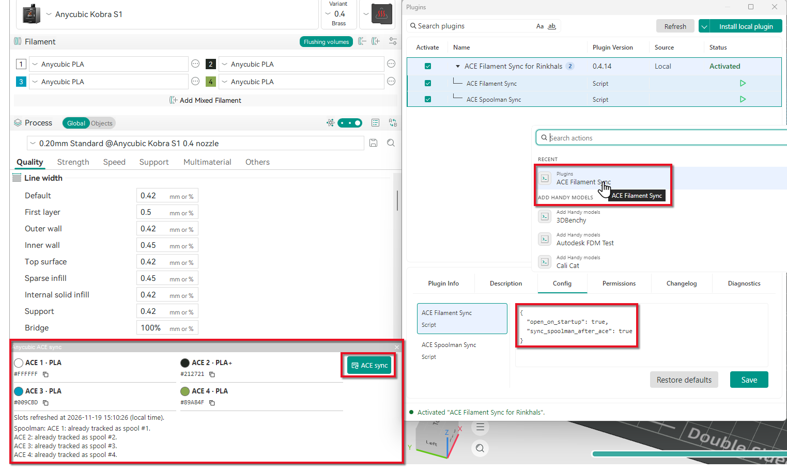

# ACE Filament Sync for Rinkhals

An independent OrcaSlicer script plugin for the Anycubic Kobra S1 with Rinkhals and one ACE Pro. It reads all four ACE slots directly from Moonraker, displays their materials and colors, and can import missing spools into Spoolman. It does not edit presets or project colors, and does not depend on Home Assistant, Anycubic Cloud, or third-party Python packages.



The screenshot shows automatic Spoolman checking enabled. It is off by default.

## Install and preview

1. Use OrcaSlicer 2.5.0 or later with Python plugin support, and enable Moonraker in Rinkhals. The latest status is in the [release checklist](docs/release.md).
2. In OrcaSlicer, open **Plugins** from the menu button next to **File**. Choose **Install local plugin**, select [ace_filament_sync.py](ace_filament_sync.py), and activate it.
3. In **Prepare**, select your Rinkhals printer. The plugin uses its saved **Printer > Connection** address automatically. Use a numeric LAN IP or a Moonraker URL, including its port if needed, not the Rinkhals management portal.
4. **ACE Filament Sync → Run** opens **Anycubic ACE sync** on the left of the Prepare workspace. If OrcaSlicer restores a previous bottom layout, drag the panel by its title bar to the left edge once and drop it when the docking preview appears. Click **ACE sync** to read the four slots and show their materials, color dots and hex codes without changing anything. The copy icon copies the six hex digits without the `#`. Allow the network request if OrcaSlicer asks.

The status below the slots shows the local date and time of the last successful refresh.

## Plugin configuration

Open **Plugins → ACE Filament Sync → Config**. Enter a JSON object with `true` or `false` (without quotes around the values). Omitted options use their defaults, so `{}` restores the defaults.

| Option | Default | What it does |
| --- | --- | --- |
| `open_on_startup` | `true` | Opens the dock when the plugin loads. Set to `false` to open it manually from Plugins or Speed Dial. Opening the dock never contacts the printer or Spoolman. |
| `sync_spoolman_after_ace` | `false` | Keeps **ACE sync** and **Spoolman** separate by default. Set to `true` to check Spoolman automatically after each successful **ACE sync** and hide the separate **Spoolman** button. Close and reopen the dock after changing this setting to update the button. |
| `preview_only` | `false` | Allows dock-triggered Spoolman imports only after confirmation. Set to `true` to show what would be imported without writing, whether the check runs manually from the dock or automatically after ACE sync. This does **not** apply to the standalone **ACE Spoolman Sync** action, which can still import after confirmation. |

For example, to check Spoolman after ACE sync without writing to inventory:

```json
{
  "open_on_startup": true,
  "sync_spoolman_after_ace": true,
  "preview_only": true
}
```

Legacy keys `printer_url`, `ace_slot`, and `orca_slot` are ignored and can be removed. Other unknown keys are rejected. Select the printer in **Prepare** to choose its connection; the plugin reads all four ACE slots and does not map them to OrcaSlicer filament slots.

## Open the panel with Speed Dial

In **Prepare**, click the 3D workspace and press **Space**. Search for **ACE Filament Sync** and click its bookmark icon to pin it. After that, press **Space** and click the pinned action, or press **Alt** plus the number shown on its tile (for example, **Alt+1**). This opens the panel without opening Plugins or running a sync.

If Space does not open Speed Dial, enable **Open the Speed Dial from the keyboard** in OrcaSlicer's Preferences. Stock OrcaSlicer 2.5 does not let a plugin add a button inside the native Filament header.

## Import ACE spools into Spoolman

Set up Moonraker's `[spoolman]` connection first; no separate address is needed in OrcaSlicer. Click **Spoolman** in the dock, run **ACE Spoolman Sync** separately, or enable the automatic check in [Plugin configuration](#plugin-configuration). The check looks for missing spools across all reported ACE slots and asks before writing.

ACE reports a product SKU when available, not a unique physical spool ID. The plugin tracks records by printer address, ACE slot and filament metadata, so rerunning an unchanged setup does not create duplicates. It cannot recognize an identical replacement spool or follow a spool that moves between slots. It skips untracked inventory matched to the same filament rather than creating a duplicate. The plugin does not assign gates, update weights, or change existing inventory. New PLA/PLA+, PETG, ABS and ASA filament entries use estimated densities; review them in Spoolman.

## Troubleshooting

- **Spoolman only previews:** Set `preview_only` to `false` in **ACE Filament Sync → Config** to enable confirmed imports.
- **No active ACE:** Check the ACE status at the printer and make sure external-spool mode is not selected.
- **Connection or HTTP error:** Check the selected printer's **Printer > Connection** address and OrcaSlicer's plugin network permissions. The plugin can only read connections exposed on the active printer preset; endpoints requiring credentials are not supported. Do not expose Moonraker to the internet.
- **Network access blocked:** In **Plugins > Permissions > Network access**, allow the printer's HTTP(S) URL and its socket host for this plugin. Then run it again. No separate Spoolman host grant is needed.
- **No usable color:** Empty, unavailable, malformed and multicolor slots are not applied. The plugin does not guess missing colors.
- **Change a project color:** Copy the ACE hex code and set it on the numbered color swatch in **Prepare → Filament**, then save the project.
- **Uninstall:** Deactivate/remove the plugin from **Plugins**. Previously saved colors are ordinary preset settings; reset the color manually or remove the dedicated copy if you no longer want it.

## Development

```powershell
python -m unittest discover -s tests -v
python .\ace_filament_sync.py http://192.168.1.50
```

The standalone command is a read-only hardware check. See the [protocol notes](docs/protocol.md), [release checklist](docs/release.md), and [MIT license](LICENSE).
